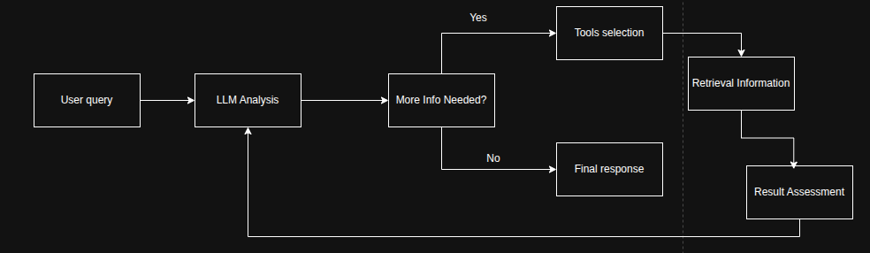
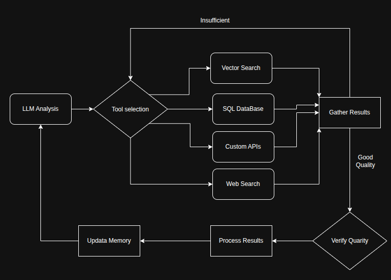
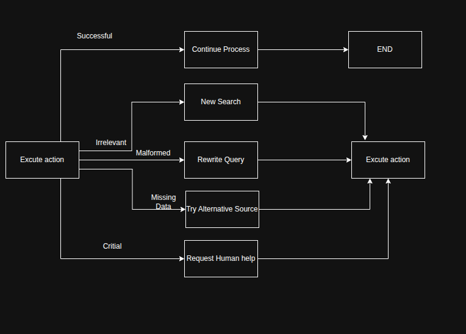

# Agentic RAG

## What is Agentic RAG:

Agentic Retrieval-Augmented Generation (Agentic RAG) is an emerging AI paradigm where large language models (LLMs) autonomously plan their next steps while pulling information from external sources. Unlike static retrieval-then-read patterns, Agentic RAG involves iterative calls to the LLM, interspersed with tool or function calls and structured outputs. The system evaluates results, refines queries, invokes additional tools if needed, and continues this cycle until a satisfactory solution is achieved. This iterative “maker-checker” style improves correctness, handles malformed queries, and ensures high-quality results.

The system actively owns its reasoning process, rewriting failed queries, choosing different retrieval methods, and integrating multiple tools—such as vector search in Azure AI Search, SQL databases, or custom APIs—before finalizing its answer. The distinguishing quality of an agentic system is its ability to own its reasoning process. Traditional RAG implementations rely on pre-defined paths, but an agentic system autonomously determines the sequence of steps based on the quality of the information it finds.

### Define Agentic Retrieval Augmented Generation (Agentic RAG)
"Maker-checker" style of operation is disigned to improve correctness, handle malformed queries to structured databased(eg: NL2SQL), and ensure balanced, and high-qualify results.
Rather relying solely of carefully engineered prompt chain, this systems active owns its reasoning processing. It can rewrite query that fail, choose different methods, and integrate multiple tools
suck as vector seach in Azure AI Search, SQL databases, or custom APIs - before finalizing its answer. This removes the need for overly complex orchestration frameworks. Instead of simple loop
<LLM call -> tool use  -> LLm call> 
can yeild sophiticated ans well ground output.

 Owning the reasoning process

Tradditional RAG implementations often depend on human pre-defining a path for the model: a chain-of-thought that outline what to retrieve and when. But when system that truly agentic, it internal decides how to approach this problem. it's not just executing script, It's autonomously determing the sequence steps based on the quality of the information it finds. 

### Integration loop Tool Integration and Memory:

An agentic system relies on a looped integration pattern:

+ Initial Call: The user’s goal (aka. user prompt) is presented to the LLM.
+ Tool Invocation: If the model identifies missing information or ambiguous instructions, it selects a tool or retrieval method—like a vector database query (e.g. Azure AI Search _ Hybrid search over private data) or a structured SQL call—to gather more context.
+ Assessment & Refinement: After reviewing the returned data, the model decides whether the information suffices. If not, it refines the query, tries a different tool, or adjusts its approach.
+ Repeat Until Satisfied: This cycle continues until the model determines that it has enough clarity and evidence to deliver a final, well-reasoned response.
+ Memory & State: Because the system maintains state and memory across steps, it can recall previous attempts and their outcomes, avoiding repetitive loops and making more informed decisions as it proceeds.

Over time, this creates a sense of evolving understanding, enabling the model to navigate complex, multi-step tasks without requiring a human to constantly intervene or reshape the 
prompt.

### Handling Failure Modes and self correction
Agentic RAG Autonomy also involves rebust self connection mechanisms. When system hits dead ends such as retrieving irreleving document or encountering malformed queries-it can:

+ Iterav and ReQuery:Instead of return low value responses, the attempts new seach strategies, rewrite database queries or look at alternative data sets.
+ Use Diagnotic tools: Systems may invoke additional functions design to help it debugs its reasoning steps or confirm the correctness of retrieved data. Tools like Azure AI Tracing  will be important to enable robust observability and monitoring.
+ Fallback Human Oversight: For high-stakes or repeatedly failing scenarios, the model might flag uncertainty and request human guidance. Once the human provides corrective feedback, the model can incorporate that lesson going forward.
