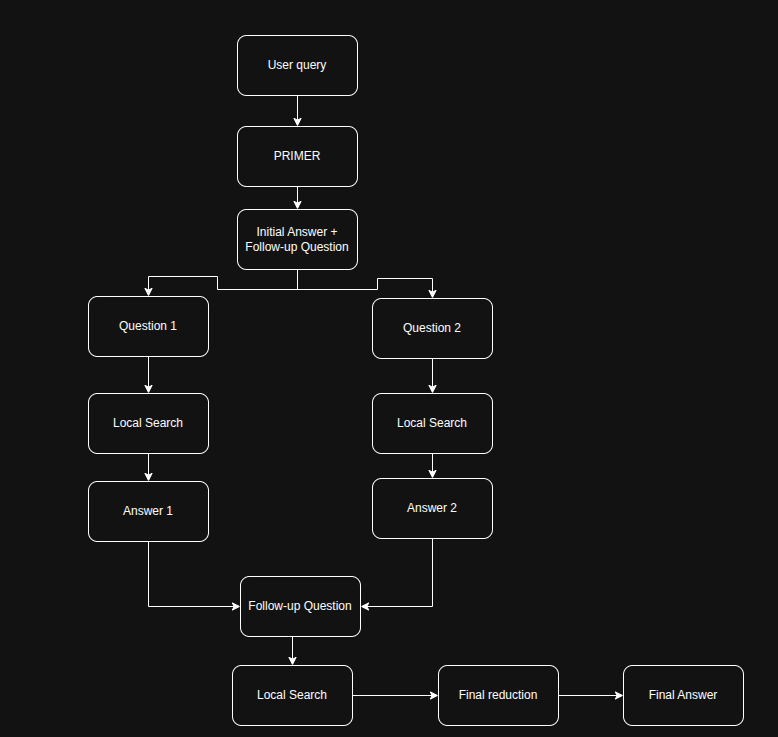

Traditional RAG:
RAG: Technical help LLM find the answers exactly base on the real external information.
Most popular: Base line RAG - Using vector similar search: Origin document will divide into chunk, embedding and similarity serch from  query.

Some several Drawback:
+ Answer need more relevant informations in create the conbine insight, but in vectore search often not find enough information to connect all field.
+ It usually fail or don't reach hight  ACC in complex structure query

# Graph RAG 
  Advanced question-answering system that combines the power of graph base knowledge represetaion with retrieval-argumented generation.
It processes input documents to create a rich knowledge graph, which is then use to enchance the retrieval and generation of answer to user queries.
The system leverages natural language processin, MC, and graph theory to provide more accurace and contextually relevant responses

This system run base on the graph + summary(each community was build folowing buttom-up aproach) to provide the context for LLM. Instead of finding the same work in each sentance text.
Overal Graph RAG will have 2 phase:

1. **Indexing** - build **knowledge graph**, divide into **communities**, create **summary** from communities.
2. **Query** - Using the indec structure to find the answer. Base the the question, it will using different search methob to find the suitable info.

## Indexing
### Basic graph RAG

Indexing in GraphRAG was design like workflow module, each workflow will read data and save at each artifact(parwuet). All the output will be normalize by one Knowledge Model 

The subject of Knowledge Model:
| Term | Description |
|---|---|
| **1. Document** | Input document (e.g., `.psd`, `.csv`, `.txt` files) |
| **2. TextUnit** | A small piece of text used for analysis |
| **3. Entities** | Objects in the document (e.g., people, locations, governments) |
| **4. Relationship** | Relationships between entities |
| **5. Covariate** | A claim extracted from the text, or information about a specific time period |
| **6. Community** | A group of entities/relationships formed through hierarchical clustering |
| **7. Community Report** | A summary of the content within a community |

## Process
In one pipeline usual was divide into each phase process then:

1. Compose Textunits: Documeny will divide into more TextUnit with feature compare the original text for result when process after that. With each chunk was define before that (usually 1200 token). 
    
    Note: chunk with size large will get more information but it will reduce accuracy of result extraction.
2. Document Processing: each document will connect with its TextUnit to know what is the token was create from what textunit. 
3. Graph Extraction: extract Entities and relationship, Claim  from TextUnit. With each **entity** duplicate **title/type** or **relationship** duplicate source/target from different TextUnit will be combine into one list.
4. Graph augmentation: from entities-relationship was extract above. Using Hierarchical Leiden  to create multi-layer communoty structure.
5. Community summarization: with each community will using LLM to create **Community Report**(summry the key information of that). High-level reports provide a comprehensive overview of the entire graph, while low-level reports offer a detailed view of a local cluster. 

6. Text Embedding

## Query
In GrapRAG will provide Query Engine with 4 methob search:
### 1. Local search: 
Focus on the one entity or object was in the query. 

    EX: What are the medicinal uses of chrysanthemum flowers?
Methob **fan-out** extract from the  entity relative with query(question).Then explore to relationships of this entity.

**Overral Structure Local Search in graph RAG**

### 2. Global Search
Using  **map-reduce** methob (divide the query smaller to compare with resport and combine all the results to create the final answer) to finding all **Community report** was create from **Community summarization** step at Indexing above. 

the Idea of **map-reduce** methob is shuffle all community report then divide it to more small batch to process at the same time. Each batch be LLM summary into RIR(Rated Intermediate Response) then get the top answer and combine into the final answer.

**Overral Structure Global Search in graph RAG**

### Golal Search in Graph RAG

### 3. DRIFT(Dynamic Reasoning and Inference with Flexible Traversal) Search
Combine **Global search** and **Local search**.

The idead: throught **Community Report** in **Global search** to extract the suitable initial point and go together is detail follow-up question then using **Local search** using the detail follow-question before that to find the detail answer this can crean more loop. All resuls and follow-up question was build into output hierarchy then combine it to create the final answer.

**Overral Structure DRIFT Search in graph RAG**

### 4. Basic search
traddition search

## Methobs details at graph_rag.py:
1. Document Processing
    Input documents are split into manageable chunks.
    Each chunk are embedding with language model.
    A vector store is create for these embeddings fot efficient similarity search.
2. Knowledge graph construction:
    Graph nodes are created for each text chunk.
    Concepts are extracted from each chunk using a combination of NLP techniques and language models.
    Extracted concepts are lemmatized to improve matching.
    Edges are added between nodes based on semantic similarity and shared concepts.
    Edge weights are calculated to represent the strength of relationships.
3. Query Processing:

    The user query is embedded and used to retrieve relevant documents from the vector store.
    A priority queue is initialized with the nodes corresponding to the most relevant documents.
    The system employs a Dijkstra-like algorithm to traverse the knowledge graph:
        Nodes are explored in order of their priority (strength of connection to the query).
        - For each explored node:
            Its content is added to the context.
            The system checks if the current context provides a complete answer.
            If the answer is incomplete:
            The node's concepts are processed and added to a set of visited concepts.
            Neighboring nodes are explored, with their priorities updated based on edge weights.
            Nodes are added to the priority queue if a stronger connection is found.
            This process continues until a complete answer is found or the priority queue is exhausted.
            If no complete answer is found after traversing the graph, the system generates a final answer using the accumulated context and a large language model.
4. Visualization:

    The knowledge graph is visualized with nodes representing text chunks and edges representing relationships.
    Edge colors indicate the strength of relationships (weights).
    The traversal path taken to answer a query is highlighted with curved, dashed arrows.
    Start and end nodes of the traversal are distinctly colored for easy identification.

