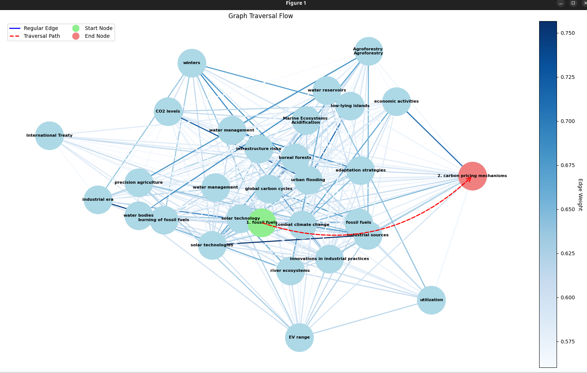
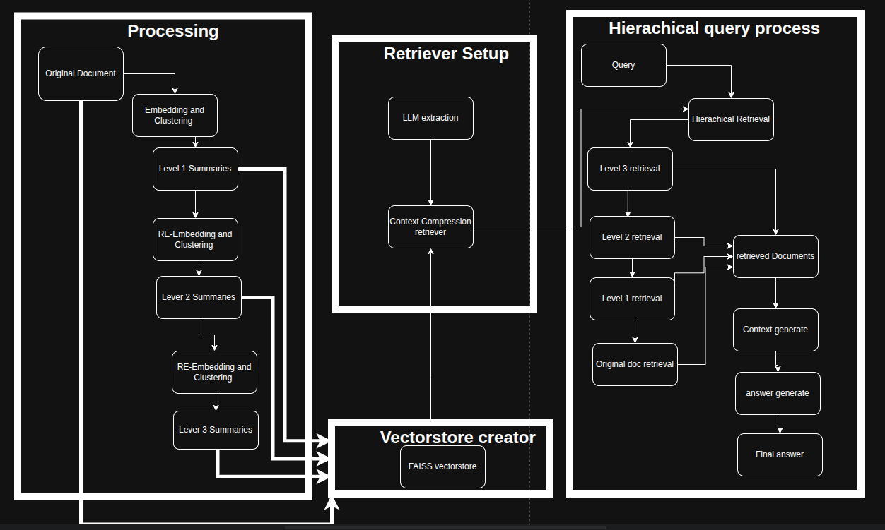
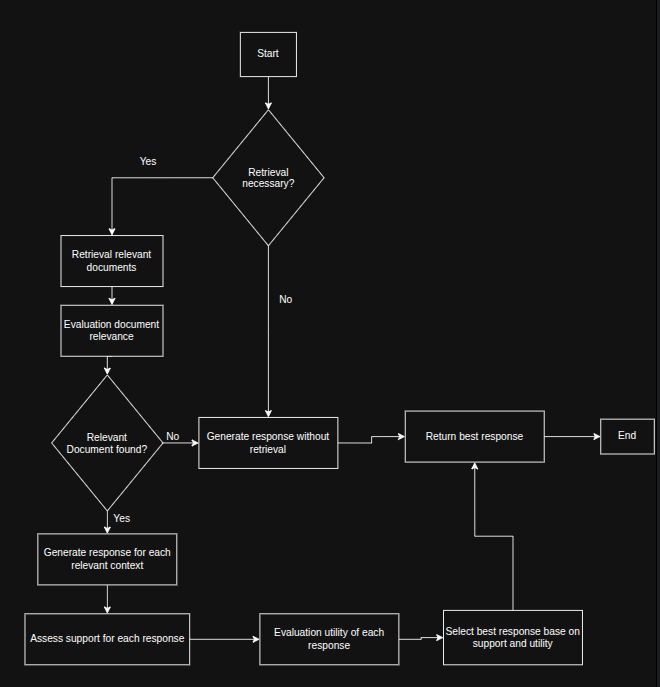
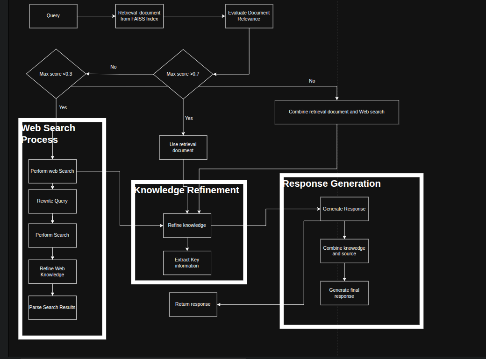
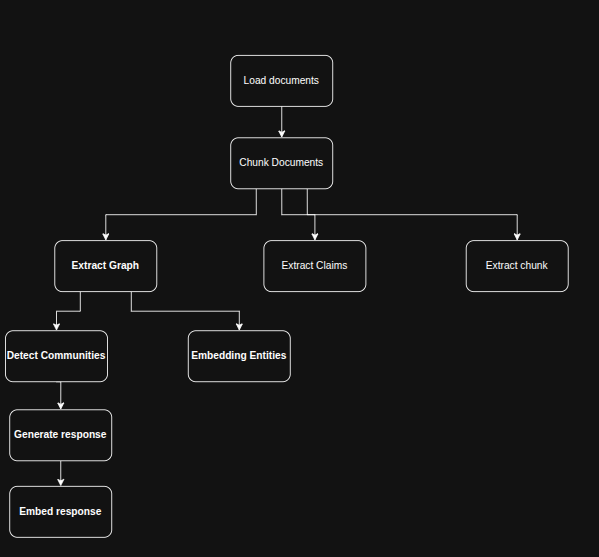
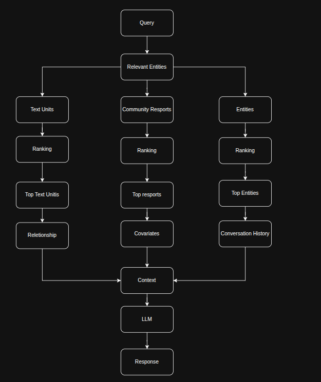
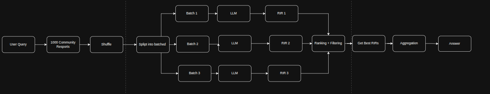

<!--  -->

## RAGTOR: 

Advanced infomation retrieved and question-answer system combine hierachical document summarization, embedding base-on retrieval, and context answer generation.
Is aims to efficiently handle large documents connection.

Key components
1 Tree building: Creates a hierachical structure  of document summaries
2 Embedding and Clustering: Original docunemts and summaries base on semantic similarity
3 Vectorstore: Efficiently stores  and retrieves docment and summary embedding
4 Contextual Retriever: Select the most relevent information for a given query
5 Answer Generation: Produces Coherent response base on retrieved information

Methos Details

Tree building 
    1: Start with original documents as level 0
    2: For each level:
        Embedding text using llm
        Cluster embedding (Using Gaussian Mixture Models)
        Generate summaries for each cluster
        Use these summaries as the text for the next level
    3 Continue until reaching a single summary or maximun levels

Embedding and Retrieval
    1 Embed all documents and summaries from all level of the tree
    2 Store these embeddings in a vectorestore (FAISS) for efficient similarity search
        embed the query
        Retrieve the mose similar documents summaries from the vectorestore

Contextual Compression
    Take the retrieved documents/summaries
    Use LLM to extract only the most relevant parts for the given query

Answer Generation
    Combine the relevant text into context
    use LLM to generate the the answer base in this context and user query

## Self-Rag 
An advanced algorithm that combines the power of the retrieval-based and generation-based approaches in NLP.
It dynamically dicides Whether to use retriever information and how to best utilize it in generating responses, aim to produce more accurate,
relevant and useful output.

Motivation:
Tradditional quesion-answering system often struggle with bandlancing the use of retrieved information and generate of new content. 
Some systems might rely on heavily on retrieved data, leading to responses that lack fexibility, while orthers might generate without suffcient grounding in factual information.
Self-RAG addresses these issues by implementing a multi-step process that carefully evaluates and necessity and relevant of retrieved information, and assesses the quality of generator responses.

Methob Details:
1. Retrival Decision: The algorithm first decides if retrieval is necessary for given query. This step prevents unnecessary for query that can be answered direcly.
2. Document Retrieval: If retrieval is deemed necessary, the algorithm fetches the top-k most similar document for vectorstore.
3. Relevant Evaluation: Each retrieved document is eveluated for its relevant to the query. This step filter out irrelevent information, ensuring that only pertinent context is used for generation.
4. Response generation: The algorithm generate response using relevant contexts. If no relevant contexts are found, it generate a response without retrieval.
5. Support Assessment: Each generated response is evaluated for determine how well it is supported by the context. This step help in identifying responses that are grounded in the provided information,
6. Utility Evaluation: The utility of each response is rated, considery how well it addresses the ordinary query.
7. Response Selection: The final step involves selecting the best response base on the support assessment and utility evaluation

## Corrective RAG 
 An advanced information retrieval and response generationg system.
It extends the standards RAG approach by dynamically evaluation and connecting the retrieval process, combine the power of vectore databases, web search, LLM to provide the accurate and context-aware
response to user queries.

Motivation:
While tradditional RAG system have improved imformation retrieval and response generation.
they can still fall short when then retrieved information is irrelevant and outdated.

The Correct RAG process addresses these limitation by:
1. Levergratin pre-existing knowledge base.
2. Evaluation the relevance of retrieval information.
3. Dynamically searching  the web when necessary.
4. Refining and combining knowledge from multiple search
5. Generate human-like response on the most appropriate knowledge

Key Components
1. FAISS index: A vectore database for efficient similarity search for pre-exiciting knowledge.
2. Retrieval Evaluation: Assess the relevant of retrieval of retrieval document to the query.
3. Knowledge refinement: Extract key information from documents when necessary.
4. Web serch query rewrite: Optimize queries for the web searches when local knowledge is insufficient
5. Response generator: Create human-like responses base on the accumulated knowledge

Method Details:
1. Document Retrieval:
    Performent similar search in the Faiss index to find relevant documents
    Retrieval with top k =3 (default)
2. Document Evaluation:
    Caculate relevant search for each retrieved document
    Determines the best couse of action base on the highest relevance score
3. Corrective knowledge Acquisition:
    If high relevance (score>0.7): Use the most relevant document as-is.
    If low relevance (score<0.3): Correctly by performing a wed search with a retrieval query
    If ambiguous (0.3<=score<=0.7): Correct by combining the most relevant document with web search result
4. Adaptive knowledge processing:
    For Web search results: Refine the knowledge to extract key point
    For ambiguous cases: Combined raw document content with refined web search results 
5. Response Generation:
    Uses a language model to generate a human-like response base on the query and acquired knowledge
    Include source information in the response for transparency

## Graph RAG 
  Advanced question-answering system that combines the power of graph base knowledge represetaion with retrieval-argumented generation.
It processes input documents to create a rich knowledge graph, which is then use to enchance the retrieval and generation of answer to user queries.
The system leverages natural language processin, MC, and graph theory to provide more accurace and contextually relevant responses

Methobs details:
1. Document Processing
    Input documents are split into manageable chunks.
    Each chunk are embedding with language model.
    A vector store is create for these embeddings fot efficient similarity search.
2. Knowledge graph construction:
    Graph nodes are created for each text chunk.
    Concepts are extracted from each chunk using a combination of NLP techniques and language models.
    Extracted concepts are lemmatized to improve matching.
    Edges are added between nodes based on semantic similarity and shared concepts.
    Edge weights are calculated to represent the strength of relationships.
3. Query Processing:

    The user query is embedded and used to retrieve relevant documents from the vector store.
    A priority queue is initialized with the nodes corresponding to the most relevant documents.
    The system employs a Dijkstra-like algorithm to traverse the knowledge graph:
        Nodes are explored in order of their priority (strength of connection to the query).
        - For each explored node:
            Its content is added to the context.
            The system checks if the current context provides a complete answer.
            If the answer is incomplete:
            The node's concepts are processed and added to a set of visited concepts.
            Neighboring nodes are explored, with their priorities updated based on edge weights.
            Nodes are added to the priority queue if a stronger connection is found.
            This process continues until a complete answer is found or the priority queue is exhausted.
            If no complete answer is found after traversing the graph, the system generates a final answer using the accumulated context and a large language model.
4. Visualization:

    The knowledge graph is visualized with nodes representing text chunks and edges representing relationships.
    Edge colors indicate the strength of relationships (weights).
    The traversal path taken to answer a query is highlighted with curved, dashed arrows.
    Start and end nodes of the traversal are distinctly colored for easy identification.

### Basic graph RAG

### Local Search in graph RAG

### Golal Search in Graph RAG
