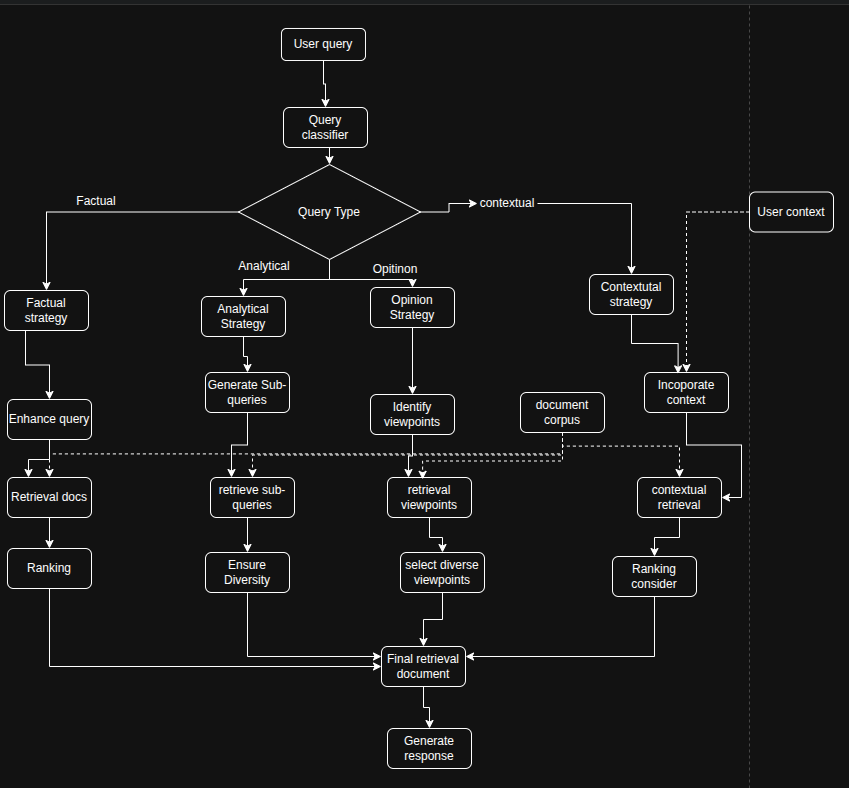

 # Feedback loop
 Implment RAG approach  with an interagted feed backloop. 
 It aim to improve the quality of relevance over time by incorporate user feed back and dynamically adjusting the retrieval process

 Key components:
1. PDF content extraction: extract text from PDF documents
2. Vectorstore: store and indexes document embedding for efficient retrieval
3. Retriever: fetches relevant documents base on user query
4. languare model: generate response using retriever documents
5. Feetback Collection: Gathers user feedback on response quality and relevance
6. Feetback Storate: presists user feedback future user
7. relevance score adjustment: Modifile document relevance base on feeb back
8. index Fine tune: Periodically updates the vectorstore using accumulated feedback

# Addaptive retrieval 
Adaptive Retrieval Augumented Generation system
Implement advanced  retriever augumented generation approach that adapts its retrieval strategy base on type of query. By leveraging LLM in various stages, it aims to provide more accuracy, relevant, and context response to user queries

Key components:

1. Query classfier: Determines the types of query(Factual, Analytical, opinion or contextual)
2. Apdated retrieval stages: Four distinct strategies  tailored to different query type:
    + Factual strategy
    + Analytical strategy
    + Opinion strategy
    + Contextual strategy
3. LLM Intergration: LLm are used thoughtout the process to enchance  retrieval and ranking
4. Open AI Model: Generated final response usin the retrieval documents and context

Benefits of This Approach
Improved Accuracy: By tailoring the retrieval strategy to the query type, the system can provide more accurate and relevant information.

Flexibility: The system adapts to different types of queries, handling a wide range of user needs.

Context-Awareness: Especially for contextual queries, the system can incorporate user-specific information for more personalized responses.

Diverse Perspectives: For opinion-based queries, the system actively seeks out and presents multiple viewpoints.

Comprehensive Analysis: The analytical strategy ensures a thorough exploration of complex topics.

